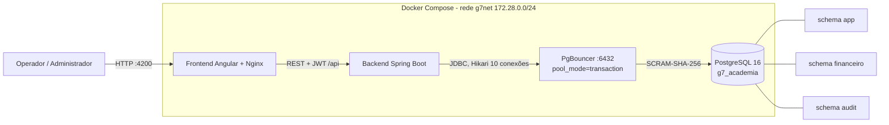
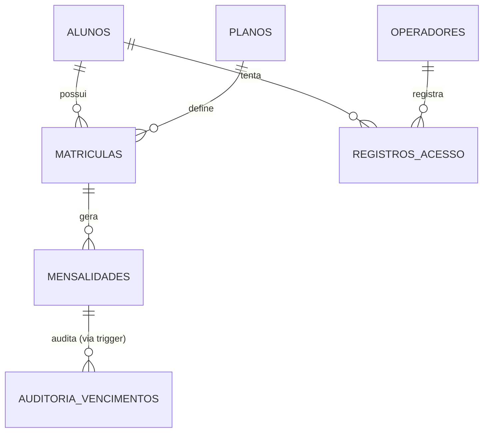

# Arquitetura — G7 (Controle de Frequência e Mensalidades de Academia)

## Camadas
| Camada | Tecnologia | Responsabilidade |
|---|---|---|
| Frontend | Angular (SPA), Nginx | Telas, guards, interceptor JWT; nenhuma regra de negócio crítica |
| Backend | Spring Boot 3 / Java 21 | Controllers → Services (regras) → Repositories; Spring Security + BCrypt + JWT; `@Scheduled` chama a Procedure de inadimplência |
| Pool | PgBouncer 1.22+ | Concentra conexões (transaction pooling), SCRAM, prepared statements (`max_prepared_statements`) |
| Banco | PostgreSQL 16 | Schemas, roles, Function, Procedures, Triggers, Views, MV, auditoria, pgcrypto |

## Banco de dados
Schemas: `app` (operadores, alunos, planos, matrículas, acessos), `financeiro` (mensalidades, views e MV), `audit` (auditoria de vencimentos).

## Regra de inadimplência
Bloqueio quando `CURRENT_DATE > data_vencimento + 5` com mensalidade PENDENTE/ATRASADA. Três mecanismos: (1) trigger em `financeiro.mensalidades`; (2) `financeiro.sp_atualizar_inadimplencia()` agendada no Spring (o tempo sozinho não dispara trigger); (3) revalidação em `app.fn_verificar_acesso()` no momento do acesso. Aluno `INATIVO` nunca é alterado automaticamente.

## Segurança
- `rl_leitor`: SELECT (sem `senha_hash`). `rl_escritor`: SELECT + INSERT/UPDATE (sem DELETE e sem escrita direta em `audit`).
- Usuários: `app_user` (rl_escritor, usado pelo backend via PgBouncer) e `leitor_user` (rl_leitor). Nenhum é superusuário.
- Trigger functions e procedures `SECURITY DEFINER` com `search_path` fixo.
- `pg_hba.conf`: somente 127.0.0.1 e 172.28.0.0/24, `scram-sha-256`; demais origens `reject`.
- `statement_timeout=30s`, `idle_in_transaction_session_timeout=60s`, `password_encryption=scram-sha-256`.
- pgcrypto: senhas dos seeds geradas com `crypt(..., gen_salt('bf'))` (BCrypt, compatível com Spring Security).
- Auditoria: o backend informa o usuário com `set_config('app.usuario', ..., true)` na mesma transação do UPDATE.

## Decisão documentada: PgBouncer como quarto serviço
O enunciado cita db, backend e frontend, mas exige PgBouncer; ele entra como serviço auxiliar de infraestrutura entre backend e banco.
